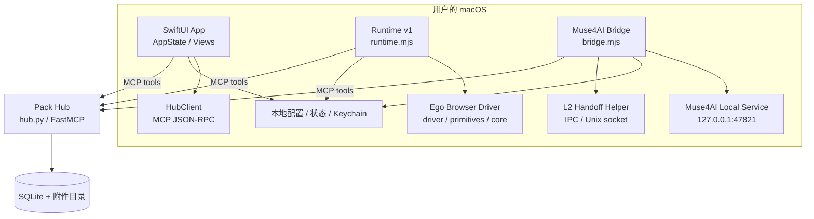
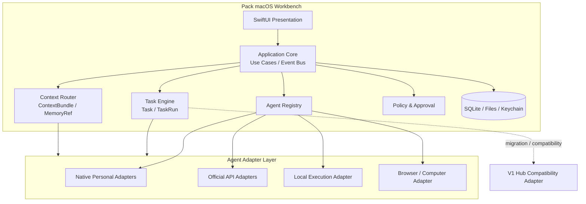

# Pack v2 现状架构图与模块边界

> 日期：2026-11-21。基于 `v2-product-alignment` 当前源码静态审阅及 GitHub Actions #146。本文描述仓库代码结构，不等于生产部署拓扑或真实 Agent 接入验收。

## 1. 当前架构结论

Pack 当前是三条主要运行路径共享一个 Hub 的 v1 系统，而不是已经模块化的多 Agent 平台：

1. **macOS App**：SwiftUI 原生客户端；`AppState` 管理大部分界面状态、轮询、业务动作与 Hub 工具调用；`HubClient` 自己实现 MCP Streamable HTTP / JSON-RPC。
2. **Hub**：`hub/hub.py` 单文件约 5,397 行；在 `build_server()` 内注册75 个 MCP 工具，负责成员认证、权限闸门、任务状态机、消息/房间、批准、记忆、技能、附件、审计、SQLite 持久化与后台 sweeper。
3. **Runtime**：`runtime/runtime.mjs` 约 525 行（抽取后），负责轮询、任务认领/交付、审批等待、闲聊、额度自报、地址发现和 ego-browser 驱动编排；复用 `pack-contracts.mjs`、`runtime-helpers.mjs`、策略模块。
4. **Muse4AI Bridge**：`runtime/muse4ai-bridge/bridge.mjs` 约 302 行，另有自己的 Hub MCP 客户端和 Muse4AI 本机 HTTP 客户端，读取独立状态/凭证文件，访问 `127.0.0.1:47821`。
5. **L2 handoff**：通过本机 IPC/socket 将任务交给 headless 引擎；与 Runtime、Bridge 不是同一个生命周期，必须作为独立执行器边界处理。

## 2. 当前调用关系

说明：App、Runtime、Bridge 都直接调用 Hub MCP；当前没有独立的 Application Core / Agent Registry / Context Router 服务层。图中本地服务和进程关系来自源码配置，具体运行状态仍需 Mac 本机复核。

## 3. 模块现状与问题

| 领域 | 当前代码位置 | 当前职责 | v2 目标边界 |
|---|---|---|---|
| macOS UI | `app/Sources/PackApp/Views.swift`、`PackApp.swift` | 视图 + 大型 AppState | Views 只呈现；ViewModel/UseCase 负责交互；Domain 不依赖 SwiftUI |
| Hub 协议客户端 | `HubClient.swift` | 手写 MCP 会话、JSON-RPC、工具调用 | `HubTransport` 协议 + v1 MCP Adapter；新本地 Core 不直接依赖具体传输 |
| Hub 工具入口 | `hub/hub.py` `build_server()` | 75 个工具注册、认证/授权包装 | API/Transport 层与领域服务分离；保持现有 MCP schema 兼容 |
| Hub 领域逻辑 | `hub/hub.py` | 任务、成员、房间、批准、记忆、技能、附件、审计混合 | Task / Agent / Conversation / Approval / Memory / Artifact / Policy 服务 |
| Hub 持久化 | `hub/hub.py` 中 `db()`、`init()` 及 SQL | SQLite schema、查询、事务与迁移混在业务逻辑 | Repository + migration 层；先定义事务边界和契约，不先拆表 |
| 主执行器 | `runtime/runtime.mjs` | 轮询、认领、执行、完成、聊天和额度循环 | Task Engine + Scheduler + Agent Adapter + Event/Run 状态 |
| 浏览器执行 | `runtime/driver*.js` | ego-browser 命令、页面交互、结果提取 | `BrowserAgentAdapter` 或 `BrowserToolRuntime`，与任务状态机分离 |
| Muse4AI | `runtime/muse4ai-bridge/` | Muse 本地服务调用、图片产物下载、任务桥接 | `MuseNativeAdapter`，只实现统一 Agent 协议，不拥有全局任务策略 |
| L2 | `runtime/l2-handoff/` | 本机 IPC 与 headless 执行 | `LocalExecutionAdapter`，独立健康、取消、恢复和审计契约 |
| 上下文/记忆 | Hub memory 工具 + Runtime pack-contracts | 成员/项目记忆读写、任务记忆结算 | ContextBundle 与 MemoryRef；外部 Agent 私有记忆只保存引用，不复制正文 |

## 4. 源码证据与耦合点

- `hub/hub.py`：5,397 行；`build_server()` 负责注册工具，注册包装 `_gated_tool` 将身份认证、external 工具白名单和 access_mode 闸门包在工具入口。不要直接移动工具函数，否则可能改变 FastMCP 参数 schema 或授权顺序。
- `app/PackApp.swift`：包含 `AppState`（ObservableObject）和 App 入口；AppState 同时持有两个身份的 HubClient、轮询任务、连接发现状态、房间/任务/成员/附件/审批等大量状态。是 UI 重构首要耦合点，但应先抽只读服务与状态模型。
- `app/HubClient.swift`：独立手写 MCP 客户端；当前每个请求设置 `Connection: close`，有 session 恢复逻辑。不能在未做服务端兼容验证前替换为另一套网络栈。
- `runtime/runtime.mjs`：导入 task/memory contract、chat policy、runtime helpers、quota policy；同一主循环仍混合 Hub RPC、驱动进程、聊天和额度行为。
- `runtime/muse4ai-bridge/bridge.mjs`：独立 Hub 客户端和 Muse 本地服务客户端；源码中有本机绝对路径配置 `/Users/cyou/pack-runtime/config.json` 与本地端口 `47821`，属于部署配置耦合，后续应改为受权限保护的配置注入，但不能在本轮贸然改生产启动方式。
- App 的 `PackConfig` 从 `~/.pack/config.json` 读取配置并迁移凭证到 Keychain；Runtime / Bridge 使用自己的配置和状态文件。多处配置格式与凭证生命周期尚未统一。

## 5. v2 目标架构（建议）

v2 中 Pack 管理 Agent Profile、连接元数据、任务、权限、上下文路由和审计；第三方 Native Agent 的账号记忆/工具仍由第三方服务管理。API Agent 的 Memory Profile 是 Pack 自己管理的独立数据，不能伪装成原生账号记忆。

## 6. 推荐拆分顺序

### Phase A：建立契约，不改行为

1. 为现有 Hub MCP 工具生成版本化 manifest：工具名、参数 schema、角色、external 白名单、access_mode、读写副作用、调用方。
2. 建立 `HubTransport` / `HubToolClient` 抽象的设计与契约测试；暂时保留现有 Swift 和 Node 实现。
3. 给 Task、TaskRun、AgentProfile、AgentConnection、ContextBundle、Approval 建立 v2 领域模型；不映射/覆盖现有 SQLite 表。
4. 为 Native 与 API Adapter 定义能力矩阵、错误分类、连接状态、取消与流事件契约。

### Phase B：先抽取 Runtime，不动 Hub 核心

1. 将 Hub RPC、任务轮询/认领、执行器、聊天、额度自报、地址发现分成独立模块。
2. 为 `runtime.mjs` 保留兼容入口，模块抽取每一步都必须保持旧 contract tests 与 staging56 通过。
3. 将 Muse4AI Bridge、ego-browser、L2 明确标为 v1 adapters；不要把 Muse 专属代码混进通用 Agent Runtime。

### Phase C：App 分层

1. 先把 AppState 中纯网络调用抽成 Repository / Service。
2. 将任务、成员、房间、审批的解析与状态更新抽为独立 ViewModel/UseCase。
3. HubClient 先实现协议兼容层；新 UI 通过 Application Core 调用，不直接触碰 MCP tool name。
4. 逐面迁移 UI，保持现有生产功能和 UI 定稿回归。

### Phase D：Hub 渐进模块化

1. 先从 `hub.py` 提取无副作用纯函数和 schema/validation 模块。
2. 再抽 Repository 和事务服务；数据库迁移仍集中管理。
3. 最后按领域抽 Tool Router / Service，保持 75 个现有工具名、参数、权限顺序和返回 schema 不变。
4. 每个提取批次对比 MCP tools/list、JSON schema、角色权限矩阵、DB migration 和全量 staging 回归。

### Phase E：Agent Registry 与适配器

1. 先实现 API Adapter 的 mock contract 与一个官方 API provider，验证连接、流式输出、取消、错误和密钥管理。
2. 再实现 Native Personal Adapter 的能力探测与登录状态管理；只采用服务方允许的官方客户端/公开接口/授权连接器。
3. ChatGPT、豆包分别做可行性验证；没有稳定、允许的接口时明确标注 unsupported/experimental，不用 DOM 注入或 Cookie 抽取冒充原生集成。
4. 每个 Agent Profile 记录 access_mode、capabilities、credential_ref、memory_boundary、tool_policy 和 adapter_version。

## 7. 不可破坏的兼容约束

- Hub MCP 现有工具名、参数、返回字段与鉴权闸门顺序必须保持兼容，除非另立版本化迁移。
- `dispatcher`、`owner`、普通成员、external 成员和不同 access_mode 的权限不可合并成一个宽泛角色。
- Task 状态机、claim_token、租约、审批、transfer、审计、附件和 SQLite 事务必须有契约测试。
- App 与 Runtime 的配置、凭证不得写入仓库或日志；Keychain / 文件权限策略必须保留。
- v1 Runtime、Muse4AI Bridge、L2 交接均作为兼容适配器，直到真实 Mac 任务闭环替代并验收。
- 历史 staging 目录不因重构而删除；测试样本可提取，但保留来源和原始证据。

## 8. 本轮验证状态

| 验证 | 结果 | 证据边界 |
|---|---|---|
| GitHub Actions #146 Hub / regression | 通过 | Ubuntu CI：Hub 单元测试、默认 staging、staging56 聚合回归 |
| GitHub Actions #146 Runtime | 通过 | Node 语法检查 + `runtime/tests/*.test.mjs` |
| GitHub Actions #146 macOS App | 通过 | `swift build --package-path app`；不是 GUI/UI 视觉验收 |
| 生产 Hub / 数据库 | 未验证 | 本轮没有生产访问或部署 |
| Native ChatGPT / 豆包 | 未验证 | 没有真实适配器连接测试 |
| L2 真实交接 | 未验证 | 既有记录要求暂停再次点击，须另行授权与复验 |

## 9. Runtime 模块化进展（2026-11-21）

本轮在 `v2-product-alignment` 分支持续进行纯提取，旧入口 `runtime/runtime.mjs` 保留：

| 模块 | 文件 | 已提取职责 |
|---|---|---|
| Hub RPC Transport | `runtime/hub-rpc-client.mjs` | MCP JSON-RPC、SSE 响应、Session ID 与重置 |
| Driver Process Adapter | `runtime/driver-runner.mjs` | ego-browser 子进程、脚本组合、结果解析与取消 |
| Runtime State Store | `runtime/runtime-state-store.mjs` | chat-state 与 delivery-receipts JSON 读写、原子替换、0600 权限 |
| Task Lifecycle | `runtime/task-lifecycle.mjs` | 任务认领、转交认领、claim token 校验、网络故障重试与失败阻断 |
| Approval Manager | `runtime/approval-manager.mjs` | Dispatcher 审批请求、决策识别、等待期间任务状态检查与超时 |
| Delivery Manager | `runtime/delivery-manager.mjs` | 交付回执持久化、任务匹配、防重复发送、完成确认与恢复 |
| Task Driver Execution | `runtime/task-driver-execution.mjs` | Driver 长任务执行、Claim Token 心跳续约、持有权丢失中止与结果复用 |
| Task Executor Context | `runtime/task-executor.mjs` | 任务记忆加载缓存、上下文不可信标记与 Prompt 组装 |
| Scheduler | `runtime/scheduler.mjs` | Hub 心跳、审批检查、任务筛选与派发、聊天/配额协调、轮询故障恢复 |

对应契约测试位于 `runtime/tests/`。审批管理与交付管理已从 Runtime 入口抽离；转交任务历史审批、URL 出口审批和任务执行结果校验仍留在任务编排流程中；Scheduler 已接管主轮询与并发协调。没有更改状态文件 schema，也没有进行生产部署。

验证边界：GitHub Actions #179 的 Runtime / syntax and behavior job 已通过，审批模块纳入的测试总数为 34 项且 0 失败。Delivery Manager 与最新入口接线后的 GitHub Actions #183 已通过 Runtime / syntax and behavior job：39 项测试、0 失败。Hub 回归和 macOS 构建仍需以完整流水线最终结论为准。Task Driver Execution 与 Task Executor Context 已加入独立契约测试；Scheduler 已加入 4 项独立契约测试，并接入 Runtime 主入口。GitHub Actions #200 的 Runtime / syntax and behavior 已通过（50 项测试、0 失败），macOS App / build 已通过；Hub / regression 仍在执行。macOS 本机运行验收尚未执行。
## 10. 本轮结论

当前最稳妥的工程顺序是：**先锁定 MCP 工具契约和权限矩阵 → 抽离 Runtime 模块 → 抽离 AppState 网络/业务职责 → 最后拆 Hub 单体 → 接入 API / Native Agent**。不要从重写 UI 或拆 Hub 大文件开始；那两条路径的回归半径最大。
## 11. Agent Adapter 契约骨架（2026-11-21）

新增 `app/Sources/PackApp/AgentAdapter.swift`，建立 provider-neutral 契约，并由 OpenAI Responses API Adapter 实现首个 API Provider：

- `AgentConnectionMode`：显式区分 `native` 与 `api`，不允许隐式降级。
- `AgentAdapterConfiguration`：只保存 Agent ID、Provider、模式、Keychain credential reference、可选 endpoint 与 adapter version；不包含密钥明文。
- `AgentCapability`：连接后探测会话、流式输出、附件、取消、状态、用量、工具调用和原生记忆等能力。
- `AgentAdapter`：定义 connect、capability probe、session listing、send、stream、cancel、status、usage 和 disconnect。
- `AgentAdapterRegistry`：按 Agent Profile UUID 注册 Adapter，同一 Provider 可配置多个账号。

约束：Native 私有记忆和账号凭证留在 Provider 边界；Pack 只接收明确授权的会话/记忆引用。已新增 `app/Sources/PackApp/OpenAIResponsesAdapter.swift`：使用 OpenAI Responses API 的 SSE 流式输出、Keychain 凭证引用、可选 `previous_response_id` 会话续接和 token usage 读取。当前仍没有 Agent 管理 UI 或端到端真实 API 凭证验收；ChatGPT 原生个人账号与豆包 Native/API Adapter 均未实现。补充审计证据：`MemberLoginWebView.swift` 的 provider URL 白名单目前只有 `muse.ai`，它是现有 Muse 成员登录容器，不是通用第三方 Agent 登录系统；不能据此宣称已支持 ChatGPT/豆包原生账号。GitHub Actions #208 的 Runtime job 与 macOS App / build 均已通过；Hub / regression 仍在执行。
## 12. OpenAI API Adapter 首个纵向切片（2026-11-21）

- `OpenAIResponsesAdapter` 实现 Responses API 请求与 SSE 事件解析，处理 `response.created`、`response.output_text.delta`、`response.completed`、`response.failed`、`response.incomplete` 与 `error`。
- API Key 仅通过 `AgentCredentialReference` 从 macOS Keychain 读取；`AgentProfile` 不存储密钥明文。
- `AgentCredentialVault` 提供 Keychain store/read/delete，并在写入后回读校验；使用 `AfterFirstUnlockThisDeviceOnly`。
- Adapter Registry 按 Agent Profile UUID 注册，而非 Provider ID，允许同一 Provider 配置多个账号。
- API Agent 必须明确提供 model 与 Keychain reference；Native/API 模式不会互相降级。
- 当前能力声明只包含 text input、streaming output、session resume 和 usage。附件、会话列表、服务端取消尚未支持；本地停止 SSE 不等于服务端生成已取消。
- `previous_response_id` 可由上一次完成事件返回的 `session_id` 续接；本 Adapter 不伪造会话列表。

- `AgentProfileStore.swift`：本地 SQLite（WAL、FULL synchronous、schema version 1）保存 Agent Profile；目录权限 0700、数据库文件权限 0600；数据库只存 Keychain reference，不存密钥。
- `AgentManager.swift`：编排 OpenAI Profile 添加、Keychain 凭证写入、Adapter 注册、消息发送、流式事件、显式连接测试、删除和应用启动时恢复 Adapter。
- API Profile 首次创建状态标记为 `configured`，只有用户触发真实 API 测试并收到完成事件后才标记为 `connected`；避免把“钥匙串可读”误报为“远端 API 可用”。
- 多账号隔离：每个 Agent Profile 使用独立 UUID 和 Keychain account；Registry 以 UUID 为键，可同时存在多个 OpenAI 账号。

新增约束：当前 AgentManager 尚未接入 SwiftUI 导航或添加 Agent 表单；AgentManager 的真实 API 测试会产生一次 API 调用费用，必须由用户主动触发。

验证边界：GitHub Actions #222 的 macOS App / build 已通过，证明 OpenAI Adapter、SQLite Profile Store 与 AgentManager 首版可编译；Runtime job 通过。Hub / regression 仍在执行。尚未使用真实 API Key 发起线上请求，也未接入 App UI。
## 13. Agent 管理界面首版（2026-11-21）

新增 `AgentDirectoryView.swift` 与 `AgentWorkspaceState`，并在现有侧栏增加 Agent 入口：

- Agent 列表显示本机已保存的 Profile、Provider、模型和连接状态。
- 添加 OpenAI API Agent：名称、模型 ID、API Key、自定义 HTTPS Endpoint（可选）。
- API Key 在提交时写入 Keychain；表单取消会清空密钥草稿；SQLite 仅保存 Keychain reference。
- 支持显式连接测试（会产生一次真实 API 调用费用）、消息发送、SSE 流式呈现和基于 `previous_response_id` 的同一会话续接。
- 支持移除 Agent Profile 与对应 Keychain 凭证；不影响服务商账号。
- 应用启动时从 SQLite 恢复 Profile 并重建 OpenAI Adapter；连接配置已加载与远端 API 已验证使用不同状态。

验证边界：GitHub Actions #226 的 macOS App / build 已通过，Agent 管理页首版可编译；#227 的导航接入 macOS App / build 已通过。更新后的会话续接、表单密钥清理和 Adapter 恢复仍以最新 CI 为准。尚未进行真实 API Key 线上请求、视觉验收或用户 Mac 本机运行。