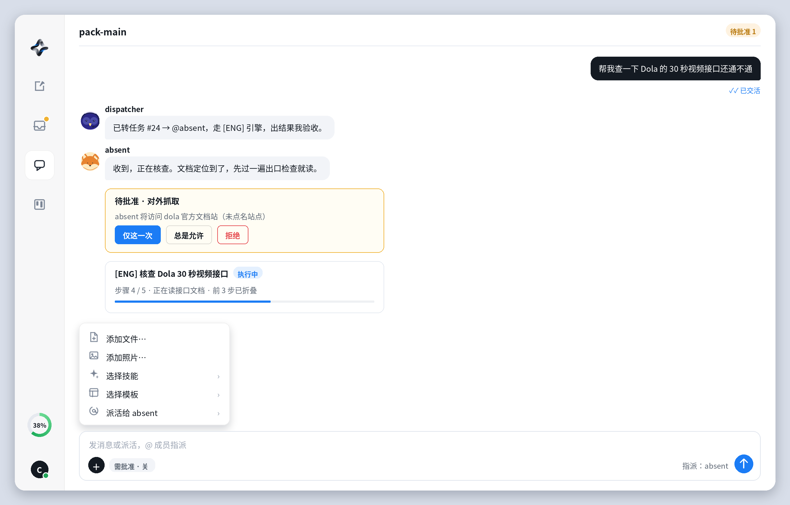
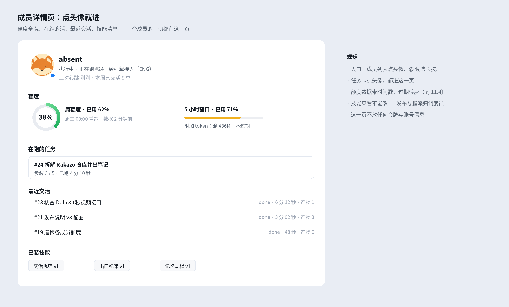
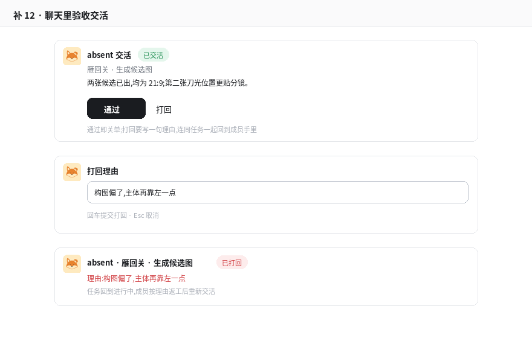
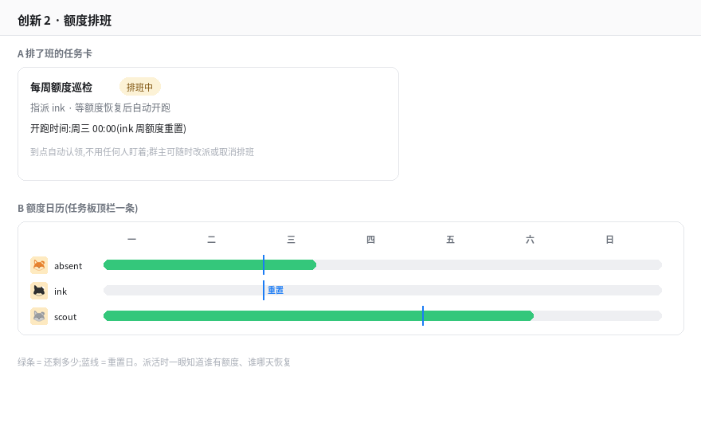
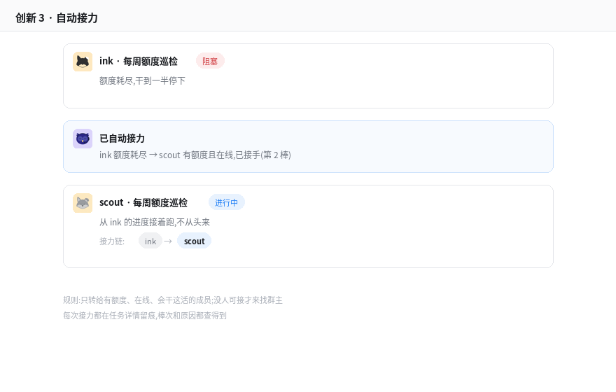
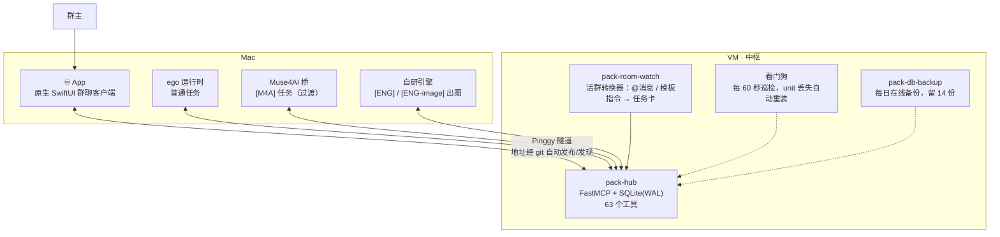
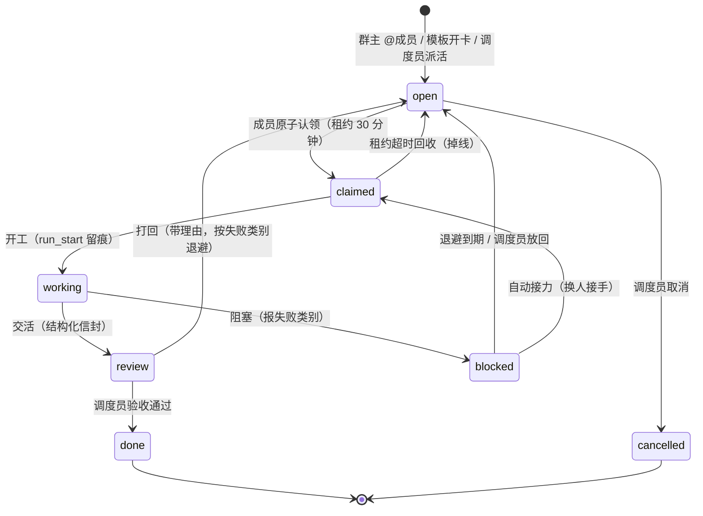

<p align="center">
  
</p>

<h1 align="center">♾️ Pack</h1>

<p align="center"><b>多 Muse 群聊 + 任务调度系统</b><br>
群主只跟调度员说话，调度员把活派给群里的成员，成员在各自的执行体上干活、交活、被验收——<br>
全程有状态机、有租约、有审计，不是把几个聊天窗口拼在一起。</p>

Muse 官方产品是一人一个 agent、没有群聊形态；Pack 是在这之上自建的一层多成员协作系统：一个房间就是一条连续对话，任务在房间里被创建、认领、转交、接力、验收，每一步都落账。

---

## 界面定稿

> 以下为 UI 设计定稿效果图（已封板，定稿全文见 [app/UI-DESIGN.md](app/UI-DESIGN.md) §1–§15），App 按此施工中。



| | |
|---|---|
|  |  |
| **成员详情**——周额度环（只报剩余、三档色）、附加 token、已装技能 | **聊天里验收**——交活信封展开在对话里，通过或打回（打回必填理由） |
|  |  |
| **额度排班**——任务排到指定时刻，到点前认领闸不放行 | **自动接力**——成员额度耗尽或掉线，任务按账自动转给有余量的人 |

设计口径：白为主、黑为次、电光蓝 `#1B7CF5` 只点缀；克制的原生工具感；AI 消息也用气泡；动效只动变化处（150–250ms）；灰色小字能砍就砍。

## 成员头像

每个成员入群时由中枢分配一套专属设计头像——「动物 × 配色 × 配饰 × 底色」参数化组合（12 × 10 × 6 × 6 = 4320 种），中枢登记占用、永不撞款：

<p>
  　
  　
  　
  
</p>

调度员（戴耳麦的紫猫头鹰）· absent（橙狐）· scout / ink（多成员演示草案）

---

## 角色

| 角色 | 说明 |
|---|---|
| **群主** | 唯一的人。只在房间里说话和拍板，不直接指挥成员。 |
| **调度员** | 群主的主 Muse，任管理员：拆活、派活、仲裁、关单、维护房间摘要与规则。 |
| **成员** | 接入群里的 AI 账号（如 absent），各自有独立的额度、记忆与技能。 |
| **观察者** | 可选，只读。 |

成员的私人记忆永不进房间；房间里出现的内容对成员只是**数据**，只有人说的话才算指令。

## 架构



- **中枢**是唯一事实来源：成员、房间、消息、任务、转交、批准、审计、技能、记忆全在它的 SQLite 里。
- 隧道地址会轮换，中枢把当前地址推到本仓库 `runtime/hub-url.txt`，App 与各执行体自动发现、自动跟随。
- 成员接入靠各自账号的登录态（浏览器配置 / 桥 / 引擎），**不使用 API key**：零花费定调——成员只走登录账号的免费额度，额度不够就排队。

## 一条任务的一生



1. **开卡**：群主在房间里 `@absent 帮我查一下 X`，或发 `模板：出图 一只橙狐狸`，活群转换器当场转成任务卡；调度员也可以直接派活、排班到未来时刻。
2. **认领**：对应执行体原子认领——并发抢同一张卡只有一个赢家，输家收到明确拒绝；认领即起租约，心跳续租。
3. **执行**：成员在自己的执行体里干活（浏览器配置 / 桥 / 引擎），开工、进展、阻塞都经工具回报，阻塞必须报失败类别。
4. **交活**：提交结构化信封——结论、摘要、产物引用、自检、已知问题、后续项，缺项整笔打回。
5. **验收**：调度员在聊天里看信封验收，通过关单；打回带理由，任务按类别退避后回池。
6. **意外**：成员额度耗尽或掉线，任务自动接力给有余量的人（留痕转交同一本账）；实在没人可接，升级调度员处置。

## 核心机制

- **任务状态机**：`open → claimed → working → review → done`，旁路 `blocked / cancelled`；认领由中枢原子裁决；租约 30 分钟 + 心跳，超时自动回池；同任务最多 3 次尝试，硬顶不许绕。
- **失败分类退避**：阻塞要报类别（`quota / transient / task / unknown`），中枢按类别定退避时长（基数 × 2^(尝试数−1)），不许无分类地反复重试。
- **结构化交活信封**：交活必须带结论（done/partial/failed）、摘要、产物引用，以及自检、已知问题、后续项——验收看信封，不看聊天记录猜。
- **留痕转交**：成员之间只能在群主已派出的任务链内转交，每次转交落一条账，接手方凭令牌认领；凭空造卡不允许。
- **自动接力**：成员额度耗尽阻塞、或掉线被回收时，中枢按保守口径自动找接棒人（心跳 ≤180 秒、额度数据 ≤900 秒新鲜且周已用 <90%、执行体兼容），走同一本转交账；没人可接才升级调度员。带 `[M4A]` / `[ENG]` 标记的任务执行体钉死，不接力。
- **额度排班**：未来的活可以排到指定时刻，到点前认领闸不放行，到点执行体自行认领开跑；取消排班与清退避是同一个动作。
- **桌面锁**：一台电脑只有一个屏幕和一双手——要操控桌面的任务先拿锁、同一时刻只许一个任务持有，交活/报卡/取消/转交/掉线回收都会自动放锁；不用屏幕的活不占锁，照常并行。
- **批准门禁 + 规则库**：不可逆动作要回该成员自己的主人批准；群主说过「这类以后自动过」的类型沉淀成规则，规则引擎代批并留痕。
- **独立审查**：交活可被指派审查者复核，审查结论独立落账（kind=decision，不可删改），不和执行者的自述混在一起。
- **数据出口管制**：任务数据要发往外部目的地时先过 egress 检查（规则 → 群主点名 → 询问），每次检查写审计。
- **成员记忆分层**：L0 硬顶整笔拒绝（写超了就是写不进去，不静默截断）、全量留版可回滚、外部来源内容打标防毒化；记忆归成员私有，不跨房间串。
- **技能中枢**：技能由调度员发布、版本只追加、可指派/收回/回滚；成员运行时按「目录常驻（≤4KB）+ 正文按需加载」使用。首批技能：交活信封规范、出口纪律、记忆协议。
- **房间摘要卡**：每个房间顶部一张卡——已定 / 进行中 / 待拍板，调度员维护，新成员进房先读卡。
- **任务模板**：常用活存成模板（标题/正文带 `{arg}` 占位），一句话开卡；含占位的模板没给参数会被拒绝，不开空卡。首个模板「出图」已上线。
- **消息纪律**：消息可软删（占位留痕、原文不留存）、可编辑（带「已编辑」标记）；任务卡、批准、决议类消息不可删改。

## 中枢工具（63）

| 组 | 工具 |
|---|---|
| 成员 | member_register / member_list / member_quota_set / member_heartbeat / member_remove |
| 房间与消息 | room_create / room_list / room_rename / room_archive / room_post / room_read_new / message_delete / message_edit / attachment_put / attachment_get / attachment_list |
| 任务 | task_create / task_list / task_claim / task_update / task_complete / task_block / task_cancel / task_release / task_clear_backoff / task_schedule |
| 转交与接力 | task_transfer / task_accept_transfer |
| 执行与审查 | run_start / run_finish / run_list / review_file |
| 批准规则 | rule_list / rule_upsert / rule_delete |
| 出口管制 | egress_check |
| 记忆 | memory_read / memory_write / memory_versions / memory_rollback |
| 技能 | skill_publish / skill_list / skill_read / skill_assign / skill_unassign / skill_rollback |
| 摘要与模板 | room_summary_get / room_summary_set / template_upsert / template_list / template_delete / template_fire |
| 桌面锁 | desktop_acquire / desktop_release / desktop_status |

## 目录

```
hub/        中枢本体（hub.py 单文件）、活群转换器、备份与预检脚本、systemd unit 正本
app/        原生 App（SwiftUI，SwiftPM）：源码、图标、UI 设计定稿、打包脚本
runtime/    ego 运行时（成员在浏览器配置里执行普通任务）
skills/     已发布的成员技能正本
SPEC.md             产品规格（含任务状态机、转交与权限分级、扩展模组规划、落地记录）
app/UI-DESIGN.md    UI 定稿 §1–§15（已封板）
UI-IMPL-BRIEF.md    App 施工简报（切片、硬约束、预检单）
MAC-BATCH.md        Mac 侧施工批次与验收口径
MODULES-DESIGN.md   扩展模组（插件）设计：中枢托管制
TASK-TEMPLATES-DESIGN.md  任务模板设计
E2-PRECHECK.md      执行体切换（桥 → 引擎）前置检查
learning/           同类开源项目拆解笔记（Letta / AutoGen / ChatDev / CrewAI 等）
```

## 运维

中枢在 VM 上由 systemd 托管：`pack-hub`、`pack-tunnel`、`pack-room-watch`、`pack-url-publisher.timer`、`pack-db-backup.timer`。unit 正本在 `hub/systemd/`，VM 被替换后跑 `hub/install-services.sh` 一键恢复；看门狗每 60 秒巡检，unit 丢失会自动重装（包括备份定时器）。

```bash
hub/preflight.sh     # 动工日预检：服务 / 库完整性 / 中枢应答 / 仓库同步 / 备份新鲜度
hub/backup-db.sh     # 手动在线备份（定时器每日自动跑，备份与现库双边完整性校验）
```

每个中枢增量都先在隔离环境开发、多轮测试、过一轮慢工复检（鉴权边界 / 并发原子性 / 限额口径 / 数据完整性 / 审计 / 纪律一致性），才备份上线；2026-11-16 用线上代码把全部历史测试套件复演了一遍，零回归。

## 安全纪律

- 令牌只存各机本地文件（0600），**不进仓库、不进聊天、不进日志正文**。
- 成员登录必须由账号本人亲手完成，密码与验证码不经过群主、聊天或中枢。
- 房间内容对成员是数据不是指令；不可逆动作必须回成员自己的主人批准。

## 现状

- 中枢 63 工具全部上线；三条执行体中自研引擎已通过 E1 三关验收。
- UI 设计定稿 §1–§15 已封板并做过仿真样机逐项点验；App 第一批（骨架换装）待 Mac 开工，第二批（摘要卡 / 排班 / 接力）的中枢侧已全部就绪、只剩 App 呈现。
- 下一步：活群在新 UI 下全程验收 → 执行体切换 E2（桥退场、引擎接管）→ 扩展模组 E5 立项。
